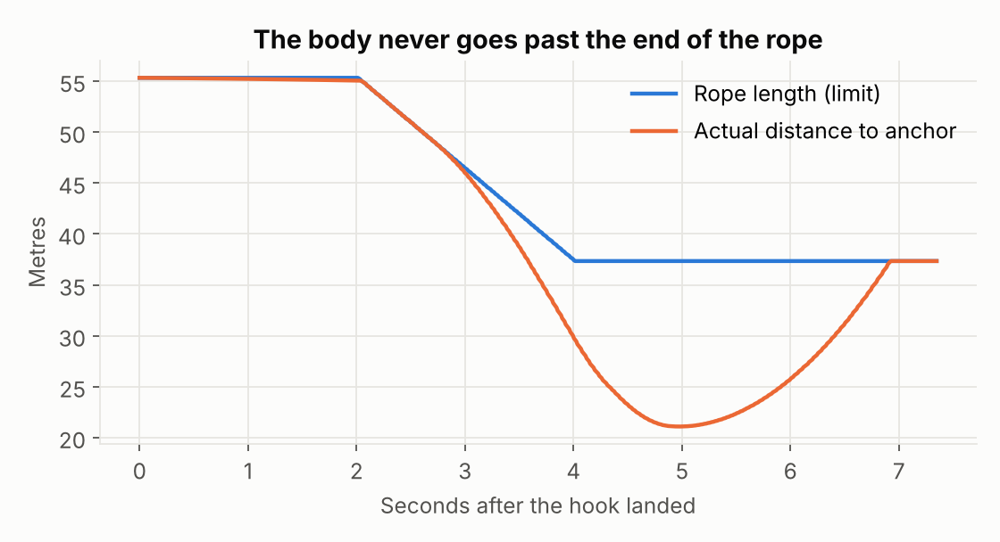
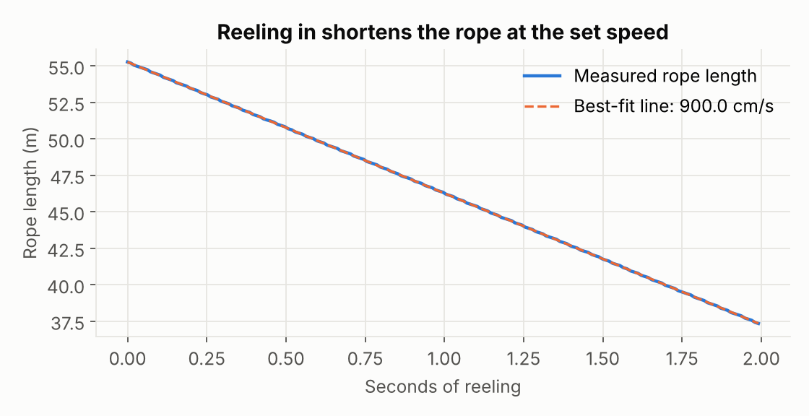
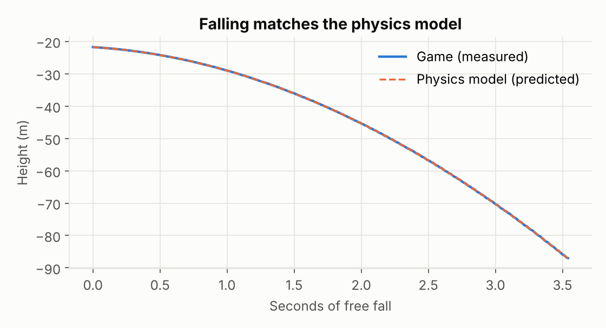
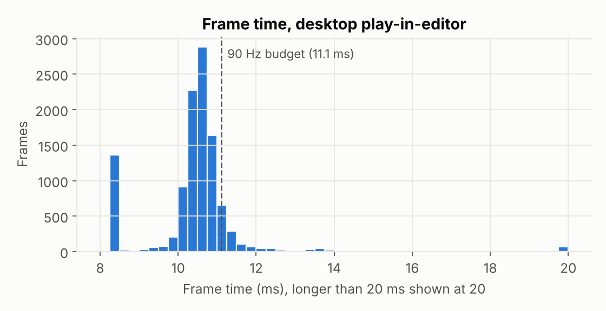
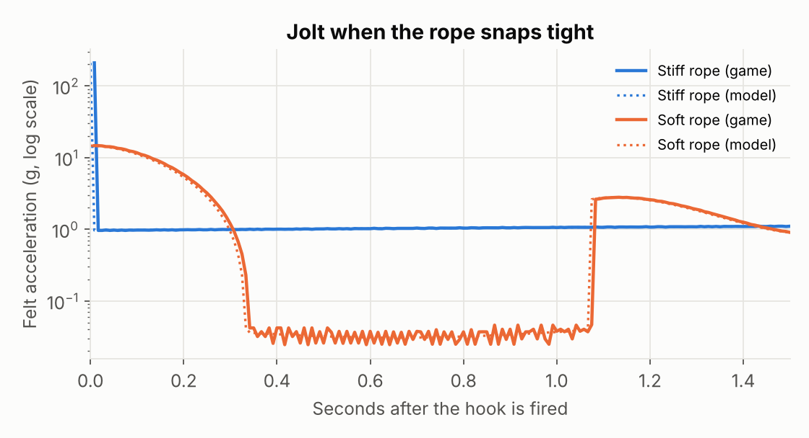
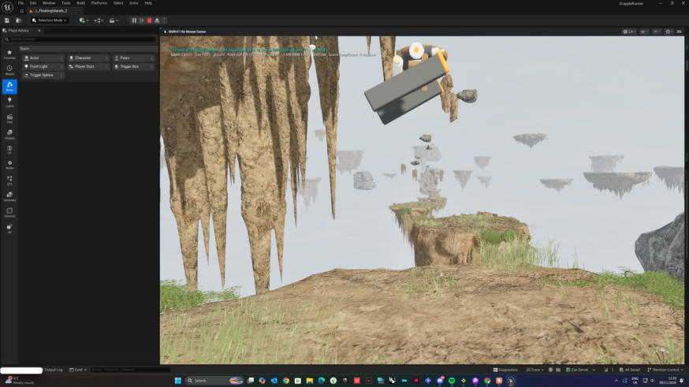
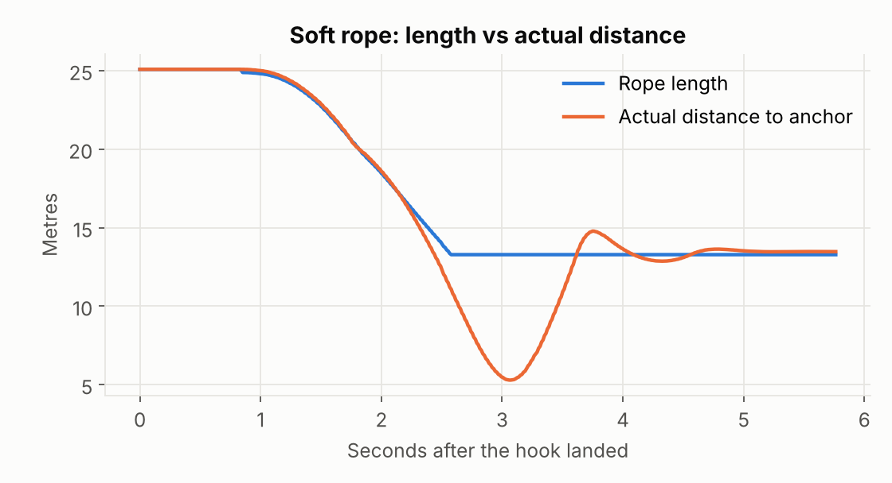

# Grapple Runner: Test Log

<!--
HOW TO READ THIS (no coding experience needed)
This file is the lab notebook for the game. Each test follows the scientific method:
  Question    - what we want to find out
  Hypothesis  - what we expect to happen, and why, written BEFORE running the test
  Method      - exact steps, so anyone can repeat the test
  Variables   - what we changed (independent), what we measured (dependent),
                and what we kept the same (controlled)
  Results     - what actually happened, with numbers where possible
  Evidence    - screenshots, recordings or logs in Docs/media/tests/
  Conclusion  - did the result support the hypothesis? what changes next?
A test PASSES when the result matches the acceptance criteria written in advance.
-->

## Test environment (applies to every test unless stated otherwise)

| Item | Value |
|---|---|
| Engine | Unreal Engine 5.8.4 (VR template, forward shading) |
| Compiler | MSVC 19.44.35229 (Visual Studio 2022 toolset 14.44.35207), Windows SDK 10.0.22621.0 |
| CPU / RAM | 12 physical / 20 logical cores, 31.8 GB RAM |
| Level | `L_FloatingIslands_2` (Brushify Floating Islands, 14 landing islands, tagged grapple anchors) |
| Mode | Desktop play-in-editor (no headset available 8 to 22 Nov 2026) |

## Summary

| ID | Date | Test | Result |
|---|---|---|---|
| T-01 | 2026-11-08 | C++ grapple module compiles and loads in UE 5.8 | PASS |
| T-02 | 2026-11-08 | Player spawns and stands on the first island | FAIL, root cause found and fixed, then PASS |
| T-03 | 2026-11-08 | Aim assist finds anchors; hook fires and sticks | PASS |
| T-04 | 2026-11-08 | The rope never stretches | PASS (largest stretch 0.00 cm) |
| T-05 | 2026-11-08 | Reel-in speed matches its setting | PASS (900.04 vs 900 cm/s) |
| T-06 | 2026-11-08 | Gravity and air drag match the physics model | PASS (g within 0.03%) |
| T-07 | 2026-11-08 | Falling off the world respawns you safely | PASS |
| T-08 | 2026-11-08 | Frame time baseline (desktop editor) | BASELINE recorded |
| T-09 | 2026-11-09 | Soft rope: does it reduce the snap jolt? (model vs game) | PASS (209 g down to 14.7 g; game matches model) |
| T-10 | 2026-11-09 | Frame-time cost of 805 plants | +0.32 ms median, flagged for VR |
| T-11 | 2026-11-09 | Flexible rope and soft rope in a real swing | Rope visuals PASS; new problem found (F6) |
| T-12 | 2026-11-09 | Auto-pull (Attack on Titan style) | PASS |

**How measurements are taken (from T-02 on).** The grapple code records every frame of play to a spreadsheet (CSV) in `Saved/Tests/`: time, frame length, position, velocity, rope length, actual distance to each anchor, gas, and what the body last touched. `Tools/analyse_telemetry.py` reads a recording, compares it with the settings written at the top of the file, prints the results and draws the charts. Both the raw recordings and the script output are kept in `Docs/media/tests/`, so every number below can be checked and the analysis re-run.

---

## T-01: C++ module build

**Question.** Does the hand-written C++ grapple code (`GrappleRig.cpp`, about 600 lines) compile against Unreal Engine 5.8 and load into the editor?

**Hypothesis.** It will compile with no errors once a compiler version that UE 5.8 accepts is installed. (The first attempt on 7 Nov failed before compiling any code: UE 5.8 refuses MSVC 14.44.0 to 14.44.35210 because of a known compiler bug, and 14.36 was too old.)

**Acceptance criteria.** Unreal Build Tool reports `Result: Succeeded` with 0 errors, and the editor opens the level with the `GrappleRunner` module loaded.

**Method.**
1. Updated the Visual Studio installs (added MSVC 14.42, and Visual Studio 2026 with MSVC 14.51). Unreal Build Tool then chose the updated 14.44 compiler, build 35229, which is past the banned range.
2. Opened the project from the Epic Games Launcher (Library, then My Projects, then GrappleRunner).
3. Unreal reported "Missing GrappleRunner Modules, rebuild them now?" Answered Yes.
4. Read the build section of `Saved/Logs/GrappleRunner.log`.

**Variables.**
- Independent: compiler toolset version.
- Dependent: build result, error and warning count, build time.
- Controlled: same source code (git commit `0dc77be`), engine version and machine.

**Results.**

| Measure | Value |
|---|---|
| Build actions | 9 (6 compile, 2 link, 1 metadata) |
| Errors | 0 |
| Compiler warnings | 0 |
| Total build time | 89.2 s (73.0 s in Unreal Build Accelerator) |
| Output | `UnrealEditor-GrappleRunner.dll` (227 KB) |
| Editor startup map check | 0 errors, 0 warnings |

**Evidence.**
- Build log excerpt: [`media/tests/T01_compile_log.txt`](media/tests/T01_compile_log.txt)
- Editor open on the level after the build: [`media/tests/T01_editor_loaded_after_compile.jpg`](media/tests/T01_editor_loaded_after_compile.jpg)

**Conclusion.** PASS. The hypothesis was supported: the code itself had no errors, and the 7 Nov failure was caused only by the toolchain. Lesson recorded: check the engine's supported compiler range before the first build (UE 5.8 needs MSVC 14.38 or newer, excluding 14.44.0 to 14.44.35210).

---

## T-02: Spawn and stand on the first island

**Question.** When Play is pressed, does the player land on the first island and stand still?

**Hypothesis.** A ray fired straight down from the PlayerStart (z = +200 cm) hits the island surface at z = −180 cm, so the player should drop 3.8 m and stand at z = −180 cm with speed 0.

**Acceptance criteria.** Telemetry shows `grounded = 1` and z within 5 cm of −180 cm within 2 s of spawning.

### Run 1: FAIL
The player fell continuously. The on-screen speed rose from 14 to 71 to 146 km/h over about 3 seconds, which is what free fall predicts (9.8 m/s² × 2 s ≈ 71 km/h). The game then respawned the player and they fell again, in a loop. ([screenshot](media/tests/T02_before_fix_falling.jpg))

### Investigation: three hypotheses, tested one at a time
| # | Possible cause | Test | Result |
|---|---|---|---|
| H1 | The islands have no collision | `Scripts/diagnose_collision.py` lists every part of the first island and its collision settings | Disproved. All 25 parts are `QueryAndPhysics`, `BlockAll`, blocking the Pawn channel ([report](media/tests/data/T02_collision_report.txt)) |
| H2 | Capsule-shaped sweeps (how the body moves) miss the island's detailed collision mesh | Same script: sweeps a 30 cm × 85 cm capsule down from the PlayerStart, with "trace complex" on and off | Disproved. All four sweeps hit `Landing_00` at z = −180 cm |
| H3 | Something in the C++ movement code | Added telemetry and a warning whenever the body starts a move already inside an object. Rebuilt in 16 s ([log](media/tests/T02_rebuild_with_telemetry_log.txt)) and replayed | **Confirmed** (below) |

The new warning fired on the first frame:

```
GrappleRig: body started inside SkyDome (StaticMeshComponent0), pushed out 358529.4 cm
```

The first telemetry row puts the player at x = −3,130 m, z = +1,750 m, outside the 4 km sky dome ([recording](media/tests/data/T02_run1_before_fix.csv)). Every level sits inside the sky dome. Because the dome was still solid, the collision code treated the player as "stuck inside" it and pushed them 3.6 km out through its wall. The player then slid down the outside of the dome forever.

**Root cause.** `place_grapple_rig.py` had switched collision off for 70 decorative parts (mist cards, sky dome, waterfalls). A check afterwards showed the mist and waterfalls were off, but the sky dome was still `BlockAll`. The change did not stick for that one object. Why exactly remains an open question; it could not be reproduced.

**Fix.**
1. Collision is now switched off in two ways (the preset and the on/off switch).
2. The object is marked as changed with `modify()`, so the save includes it.
3. The script reads the value back and warns if it is still solid.
4. `sky_and_mist.py` now makes the dome non-solid when it first creates it.

### Run 2: PASS
After the fix, the player spawned, landed and stood still at z = −180.0 cm, matching the ray-trace prediction to within 0.1 cm. The body-started-inside warning did not fire again. ([screenshot](media/tests/T02_after_fix_standing_on_island.jpg), [recording](media/tests/data/T02-T08_run2_after_fix.csv))

**Conclusion.** The first hypothesis about the cause (missing collision) was wrong, and testing each possibility separately found the real one quickly. **Lesson:** any mesh that surrounds the player (sky domes, sky spheres, weather volumes) must be non-solid, and editor scripts must read back their changes rather than assume they worked.

---

## T-03: Aim assist and firing a hook

**Question.** Does the aim assist find a grapple anchor near the crosshair, and does the hook attach there?

**Hypothesis.** When an anchor rock is within 9° of the aim direction and inside 60 m, a coloured dot appears on it (green for the left hook, blue for the right). Clicking attaches the rope at that dot.

**Method.** On desktop, looked up at the anchor rocks above the first island, then held the left mouse button.

**Results.**
- Both dots appeared on two different anchor rocks ([zoomed screenshot](media/tests/T03_aim_assist_dots_zoom.jpg)).
- The left hook attached, and a rope was drawn from the hand to the rock ([screenshot](media/tests/T03_hook_attached.jpg)).
- Telemetry recorded the rope length as 55.3 m.

**Evidence.** Recording of the whole sequence: [`T03-T05_grapple_sequence.gif`](media/tests/T03-T05_grapple_sequence.gif)

**Conclusion.** PASS. Two issues were noted for later rather than fixed now:
- **F2:** the hook reached 55 m, but the design brief's maximum rope length is 18 m. `MaxFireRange` (60 m) needs a decision.
- **F3:** the rope draws grey instead of orange, because Unreal's basic shape material has no "Color" setting for the code to change.

---

## T-04: The rope never stretches

**Question.** While hooked, is the player's distance from the anchor always less than or equal to the rope length?

**Hypothesis.** Yes, to within 1 cm. Every physics step (1/120 s), the code puts the body back onto the rope's circle and removes any outward speed (see "THE BIG IDEA" in `GrappleRig.cpp`).

**Method.** Hook on, reel in, swing, collide and release, recorded frame by frame. The measure is `ropeL_dist − ropeL_len` on every hooked frame.

**Results.** 687 frames (7.3 s) hooked, covering reeling, swinging, two collisions with islands and a slack-rope phase. **The largest stretch was 0.00 cm.** The rope also went slack correctly when the player swung inwards: the distance fell to 21.1 m on a 37.3 m rope. A rope can pull but never push, and that is what happened.



**Conclusion.** PASS. The rope behaves as an ideal inextensible rope.

---

## T-05: Reel-in speed

**Question.** When reeling in, does the rope shorten at the `ReelSpeed` setting (900 cm/s)?

**Method.** Held Shift for about 2 seconds while hooked. Fitted a straight line to rope length against time.

**Results.** Measured **900.04 cm/s** over 185 frames (1.99 s), an error of 0.005%. The rope went from 55.3 m to 37.3 m.



**Conclusion.** PASS.

---

## T-06: Gravity and air drag

**Question.** Does a falling player follow the physics model exactly: gravity 980 cm/s² plus 6% speed loss per second to air drag?

**Hypothesis.** Fitting the textbook equation for falling with drag, vz(t) = −g/k + (vz₀ + g/k)·e^(−kt), to the measured speed should give g = 980 and k = 0.060. A frame-by-frame replay of the model from the same starting point should match the recorded path.

**Method.** Used the longest stretch of free fall in the recording: after releasing the hook, until respawn. That was 3.54 s, 289 frames and a 65.2 m drop.

**Results.**

| Measure | Setting | Measured | Error |
|---|---|---|---|
| Gravity g | 980 cm/s² | 979.77 cm/s² | 0.024% |
| Drag k (vertical) | 0.060 /s | 0.0600 /s | < 0.1% |
| Drag k (sideways) | 0.060 /s | 0.0600 /s | < 0.1% |
| Position, model vs game | n/a | max 20.2 cm apart | 0.31% of the drop |



**Why the positions differ by 20 cm.** Physics runs in fixed steps of 1/120 s (8.3 ms), but frames are recorded at whatever moment they finish. Between steps, a recorded frame can be up to one step "behind". At the measured fall speed of about 25 m/s, that is 25 m/s × 0.0083 s ≈ 21 cm, which is exactly the size of the difference. So the gap comes from measurement timing, not a physics error.

**Conclusion.** PASS. Analysis output: [`T04-T08_analysis_output.txt`](media/tests/T04-T08_analysis_output.txt)

---

## T-07: Falling off the world

**Question.** If the player falls into the mist, are they returned safely to the start?

**Hypothesis.** Below the "kill height" (4,000 cm below the lowest island, z = −8,795 cm), the player is moved to the PlayerStart with zero speed, then lands.

**Results.**
- At 130.34 s the player passed the kill height (z = −87.95 m) and was moved back to the start, at z = +2.2 m.
- They landed (`grounded = 1`) at z = −180.0 cm 0.95 s later.
- Free fall predicts √(2 × 3.97 m ÷ 9.8 m/s²) = 0.90 s for that drop.

**Conclusion.** PASS.

---

## T-08: Frame time baseline

**Question.** How long does each frame take on this PC, compared with a 90 Hz headset's budget of 11.1 ms per frame?

**Method.** Frame lengths over 133 s of desktop play-in-editor (the first 5 s of loading excluded).

**Results.**

| Measure | Value |
|---|---|
| Median frame | 10.54 ms (94.9 fps) |
| 95th percentile | 11.43 ms |
| 99th percentile | 13.74 ms |
| Frames over 11.1 ms | 9.6% |



A second group of frames sits at exactly 8.33 ms (120 fps), mostly between 18 and 30 s into the run. This matches a 120 fps limit and has not been investigated yet.

**Conclusion.** Baseline recorded, not pass/fail. This was the editor on a flat screen, which adds overhead and renders one view instead of two. The real comfort test needs a packaged build in the headset. Re-measure after each graphics change.

---

---

## T-09: Soft rope (comfort fix for F1)

**Question.** If the rope has a little give, does the jolt when it snaps tight get smaller?

**Background.** F1 showed the stiff rope stops you within one physics step (1/120 s). The soft rope adds a spring and damper, like a spring-loaded reel (`bSoftRope`, `RopeStiffness`, `RopeDampingRatio`, `MaxRopeStretch` in `GrappleRig.h`). "Felt" acceleration leaves out gravity, because your inner ear can't feel it while you fall. It's measured in g.

**Hypothesis (predicted before testing in Unreal).** `Tools/rope_model.py` copies the game's rope maths into Python. It predicted the following, and also chose the softest settings that stay under 130 cm of stretch: stiffness 64, damping 0.5 ([prediction](media/tests/T09_model_prediction.txt)).
- A hook fired while falling away at 17 m/s: the jolt drops from **209.3 g to 14.7 g**, with 121 cm of stretch.
- Reeling in with the soft rope and no safeguard catapults the player. The model found this first, so a "reel stall" (`ReelStallStretch`, 20 cm) was added before the game test.

**Method.** A new console command, `gr.Test`, sets up the exact same situation every time, 300 m up in empty sky, with no player input. It runs for 3 s and records **every physics step**. Four runs: `gr.Test snap stiff`, `snap soft`, `reel stiff`, `reel soft`. Then `Tools/analyse_telemetry.py` replays the model alongside the recording.

**Results.**

| Test | Game: peak felt | Game: max stretch | Model: peak felt | Model: max stretch | Largest step-by-step difference (360 steps) |
|---|---|---|---|---|---|
| Snap, stiff rope | 209.3 g | 0 cm | 209.3 g | 0 cm | 0.012 g |
| Snap, soft rope | **14.7 g** | 121 cm | 14.7 g | 121 cm | 0.114 g |
| Reel, stiff rope | 1.4 g | 0 cm | 1.4 g | 0 cm | 0.014 g |
| Reel, soft rope | 2.6 g | 20 cm | 2.6 g | 20 cm | 0.017 g |



In-game readouts: [stiff](media/tests/T09_ingame_result_stiff.jpg), [soft](media/tests/T09_ingame_result_soft.jpg), [reel](media/tests/T09_ingame_result_reel.jpg). Data: [`T09_scripted_tests.csv`](media/tests/data/T09_scripted_tests.csv). Analysis: [`T09_analysis_output.txt`](media/tests/T09_analysis_output.txt).

**What the curve shows.**
- The soft rope spreads the jolt over about 0.3 s instead of one step.
- It then goes slack for about 0.7 s as the player rebounds, and catches again at 2.7 g: one gentle bounce.
- When reeling, the soft rope is a little harsher (2.6 g against 1.4 g), because the spring adds to the reel's pull.

**Conclusion.** PASS. The jolt fell **14 times**, and the game matched the model step for step. That match also checks the physics code: two independent copies of the maths agree. Whether 14.7 g for a third of a second *feels* acceptable needs people in headsets (see the motion-sickness study plan below).

---

## T-10: How much frame time do 805 plants cost?

**Question.** Does scattering grass, clover, flowers, heather and bushes on the 14 islands slow the frame rate?

**Method.**
- `Scripts/scatter_foliage.py` planted 805 plants on the islands' tops. They have no collision and no shadows.
- A new test, `gr.Test perf`, stands at the spawn looking down the route, always the same view, and times every frame for 10 s.
- It was run with the plants shown and hidden. Nothing else changed: same session, same view, plants toggled without saving.

**Results.**

| | Frames | Median | 95th pct | 99th pct | Over 11.1 ms |
|---|---|---|---|---|---|
| Plants hidden | 899 | 11.12 ms (90 fps) | 11.62 ms | 11.97 ms | 50.7% |
| Plants shown | 870 | 11.44 ms (87 fps) | 12.10 ms | 12.65 ms | 88.4% |



**Caveat.** Both runs sit right around 90 fps. Removing Unreal's frame cap (`t.MaxFPS 0`) didn't change that (11.16 ms), so the PC may be held at 90 fps by v-sync or the graphics card. That means the true cost could be hidden at the top end.

**Conclusion.** The plants cost about **0.3 ms per frame (+3%)**. That is small, but enough to push most frames over a 90 Hz headset's budget in the editor. **F8:** before VR testing, make the plants cheaper (instancing, cull distance, LODs) and re-measure in a packaged build.

---

## T-11: Flexible rope and soft rope in a real swing

**Question.** Does the new flexible rope look right, and does the soft rope behave in a real, hand-played swing as well as in the scripted test?

**What changed in the code.**
- The rope is drawn as a chain of 24 links with its own physics (`SimulateRopeShape`, a "Verlet rope"), so it sags when slack and straightens when tight.
- It uses a new orange material (`M_Rope`, fixing F3).
- Rope pull is now measured in **newtons** from Newton's second law (F = ma, with a 70 kg player). It shows on screen and sets how hard the VR controllers vibrate (`FeelRopeTension`), so you feel your body's weight on the rope.

**Results.**
- Rope visuals: PASS. The rope [sags in a curve](media/tests/T11_flexible_rope_sagging.jpg) when slack and [goes straight and orange](media/tests/T11_flexible_rope_taut_orange.jpg) when pulled tight.
- Soft rope in a fast swing on a 13 m rope: **problem found**.
  - The player swung in to 5.3 m from the anchor, so the rope went slack.
  - On the way back out, the rope stretched all the way to its 150 cm safety limit.
  - That limit stops you instantly: a spike of **18,838 N (27 times body weight)** and a 65 g peak.



**Conclusion.** The scripted test (T-09) used a long 37 m rope at 17 m/s. Real play produced a case it didn't cover: a short rope and a fast swing. **F6:** at stiffness 64, the soft rope is too soft for short ropes. Possible fixes:
- a progressive spring that gets stiffer the more it stretches;
- stiffness that scales with rope length.

This case also needs adding to `gr.Test` so it can be re-run exactly. Data: [`T11_swing_soft_rope.csv`](media/tests/data/T11_swing_soft_rope.csv), [analysis](media/tests/T11_analysis_output.txt).

---

## T-12: Auto-pull (Attack on Titan style)

**Question.** Naomi reported: "the rope physics work but it doesn't pull the character towards the point". Should the hook pull you in by itself, as Attack on Titan's gear does?

**Change.** New setting `bAutoPull`, on by default: once a hook bites, it reels you in by itself. Holding Shift (desktop) or grip (VR) now means "stop pulling and swing". Unticking it gives the old behaviour.

**Method.** Fired the left hook at an island's underside and held only the mouse button, no other keys.

**Results.**
- The rope reeled in from 17.1 m to 2.9 m in 2.6 s.
- 2.9 m is the minimum rope length (2.5 m) plus the reel's stall margin.
- The player rose toward the hook at up to 9.9 m/s.
- The reel was on for 100% of hooked frames without any key pressed.

Screenshots: [start](media/tests/T12_auto_pull_start.jpg), [arrived](media/tests/T12_auto_pull_arrived.jpg). Data: [`T12_auto_pull.csv`](media/tests/data/T12_auto_pull.csv).

**Conclusion.** PASS.

## Findings to act on

| ID | Finding | Why it matters | Plan |
|---|---|---|---|
| F1 | **Improved 9 Nov (T-09):** when a slack rope snaps tight, the player loses about 73% of their speed in one frame (61 to 16 km/h). Hitting an island removes 28 to 71%. ([chart](media/tests/F1_rope_snap_speed.png)) | Sudden changes in speed that your inner ear doesn't feel are a major cause of VR motion sickness. In real life a rope stretches slightly and takes the load over a moment. | Day 2: soften the snap (short elastic "give", or turn more of the speed into swing instead of deleting it). Re-run this analysis and compare peak deceleration before and after. |
| F2 | Hook range is 60 m; the design brief says the maximum rope length is 18 m | Range changes how the level must be laid out | Decide on a value on Day 2 |
| F3 | ~~The rope is grey, not orange~~ | Readability | **Fixed 9 Nov:** `M_Rope` material (T-11) |
| F4 | ~~Telemetry only logs the last physics step's collision~~ | Gaps in evidence | **Fixed 9 Nov:** collisions are now kept for the whole frame |
| F5 | Hitting an island at speed also stops you within one step (about 156 g in T-04's data) | Same sickness trigger as F1 | Soften collisions: slide more, absorb speed over a few frames |
| F6 | The soft rope is too soft for short, fast swings: it reaches its 150 cm limit and jolts (27 times body weight) | It undoes the comfort fix in real play | Progressive spring or length-scaled stiffness; add a `gr.Test swing` case |
| F7 | Rope pull (newtons) left out the reel motor's pull | Haptics would feel too weak while reeling | **Fixed in code 9 Nov:** reel and spring pull are added up per step (compiles next session) |
| F8 | Plants cost about 0.3 ms per frame and push most editor frames over 11.1 ms | VR frame-rate budget | Instancing, cull distances and LODs; re-measure in a packaged build |

## Planned: motion-sickness study (when the headset is back)

The EXIT SUIT and the game share one aim: **reduce motion sickness, and help each player learn their own limits.** That can be measured properly.

- **Measure.** The Simulator Sickness Questionnaire (Kennedy et al., 1993), the standard 16-symptom questionnaire, filled in before and after each session. Also record the time until a player first reports discomfort, and whether they stop early.
- **Compare.** Each friend plays the same route under different conditions in a different order (to cancel out "getting used to it"). For example:
  - with and without the speed vignette;
  - with and without the softened rope snap (F1);
  - with and without the suit.
- **Link to the game data.** The telemetry already logs speed every frame. So symptom scores can be compared with peak decelerations and time spent above a given speed, to find which moments make people ill.
- **Ethics.** Volunteers can stop at any time, sessions are short, and no names go in the published data.
