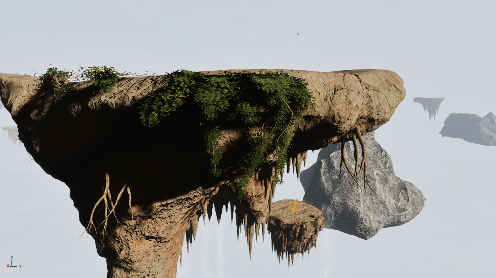

# Grapple Runner

A PC VR grapple-swing game in Unreal Engine 5.8, built by **Naomi Umoru**, and designed to be played on the EXIT SUIT full-body VR locomotion rig.

Players swing between floating islands with twin hip-mounted grapple hooks, Attack on Titan style. The plan is a Valorant-style roster: shared weapons, and different agents with abilities that bend the movement.

## What's here

| Folder | What it is |
|---|---|
| `Source/GrappleRunner/` | C++ game module. `GrappleRig` is the twin-hook grapple with a fixed-step rope constraint, reeling, gas boost, aim assist, VR and desktop input, haptics and respawn. |
| `Scripts/` | Unreal editor Python tools: procedural level builder, lighting, sky and mist pass, weapon import, rig placement. |
| `Art/Weapons/` | Procedural Blender script plus FBX exports for the blades, blade handle, grapple gear and sidearm. |
| `Tools/physics-bench.html` | A 2D swing physics test bench used to tune rope length, reel speed and gravity before porting to C++. |
| `Config/`, `GrappleRunner.uproject` | Project settings. Licensed marketplace content (Brushify etc.) is deliberately **not** in this repo. |
| `Docs/DEVLOG.md` | A dated log of every work session, with what was built and what was learned. |

## Controls (current)

| | VR (OpenXR: Vive, Index, Quest) | Desktop test mode |
|---|---|---|
| Fire / hold hook | Left / right trigger | Left / right mouse |
| Reel in | Grip | Shift |
| Gas boost | Trackpad / A / X | Space (in air) |
| Jump / walk / respawn | – | Space / WASD / R |

## Skills shown

- **Unreal Engine 5:** C++ gameplay programming (Actor, collision sweeps, input, haptics).
- **Physics:** a constraint-based rope with fixed-step integration, prototyped first as an HTML/JS bench.
- **Tools programming:** Unreal Python editor scripting for procedural level generation and lighting.
- **3D modelling:** procedural modelling in Blender Python, with FBX pipeline into Unreal.
- **VR design:** comfort constraints, multi-headset input, and hardware integration with the EXIT SUIT.

## Building

Needs Unreal Engine 5.8 and Visual Studio 2022 with **MSVC v14.42** (14.38–14.43 or 14.50; 14.44 is blocked by UE 5.8). Open `GrappleRunner.uproject` and accept the module rebuild.
